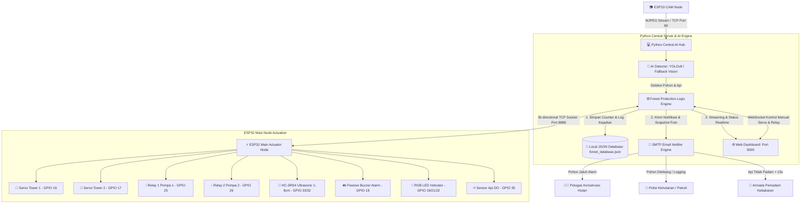
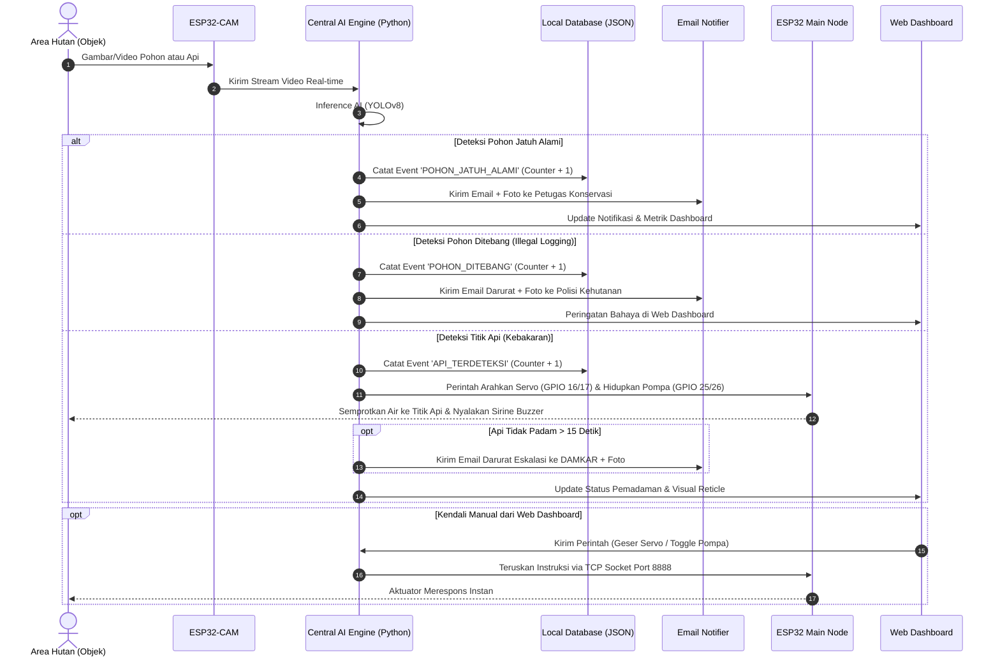

# 🌲 AIoT Intelligence Forest Protection System

Sistem perlindungan hutan cerdas terintegrasi berbasis **Artificial Intelligence of Things (AIoT)** yang menggabungkan penglihatan komputer (**Computer Vision & YOLOv8**), mikrokontroler **ESP32-CAM** dan **ESP32 Main Actuator Node**, **Web Dashboard Interaktif (Monitoring & Kontrol Komponen)**, **Penyimpanan Database Lokal (Local JSON Engine)**, serta **Sistem Notifikasi Email Otomatis ke Petugas** via protokol **TCP/IP Socket**, **WebSockets**, dan **SMTP**.

---

## 📌 Fitur Utama Sistem

### 1. 🧠 AI Vision Tracking & Klasifikasi Multi-Insiden (ESP32-CAM + Python Engine)
Sistem kamera pemantau memproses video streaming resolusi tinggi secara *real-time* untuk mendeteksi berbagai ancaman kelestarian hutan:
- **🍃 Pohon Jatuh Alami (*Natural Tree Fall*)**:
  - Mendeteksi pohon yang tumbang atau patah akibat faktor usia, cuaca ekstrem, atau angin kencang.
  - **Database Lokal**: Menambahkan akumulasi counter (`pohon_jatuh_alami` + 1) dan mencatat log kejadian lengkap dengan timestamp (tanggal & jam), posisi sektor/zona, serta tingkat keyakinan (*confidence*).
  - **Notifikasi Email**: Mengirimkan email laporan insiden secara otomatis ke Petugas Konservasi & Lingkungan Hidup lengkap dengan deskripsi detail dan lampiran foto snapshot kamera.
- **🪓 Pohon Ditebang (*Illegal Logging Detection*)**:
  - Mendeteksi tanda-tanda penebangan liar, sisa potongan pohon, atau aktivitas pembalakan liar di area lindung.
  - **Database Lokal**: Menambahkan akumulasi counter (`pohon_ditebang` + 1) dan mencatat insiden darurat ke database lokal dengan koordinat *bounding box*.
  - **Notifikasi Email**: Mengirimkan email darurat / *alert* cepat ke Polisi Kehutanan & Regu Patroli Hutan berisi bukti visual kejadian untuk penindakan cepat di lokasi.
- **🔥 Deteksi Titik Api & Pemadaman Otomatis Terarah (*Precision Fire Suppression*)**:
  - Membagi area pantauan menjadi **Area 1** (sisi kiri) dan **Area 2** (sisi kanan).
  - Menghitung koordinat sudut target api secara presisi ($0^\circ - 90^\circ$ / $0^\circ - 180^\circ$) berdasarkan titik kalibrasi visual.
  - Menggerakkan **Servo Tower 1 (GPIO 16)** atau **Servo Tower 2 (GPIO 17)** mengarahkan semprotan air ke pusat titik api.
  - Mengaktifkan **Relay 1 (GPIO 25)** atau **Relay 2 (GPIO 26)** untuk menyalakan pompa air pemadam.
  - **Mode Ganti-Gantian (*Mutual Exclusion*)**: Jika api muncul di kedua area secara bersamaan, sistem secara cerdas menyemprot bergantian (masing-masing 2.5 detik) guna mencegah penurunan tegangan (*voltage drop / brownout*) pada ESP32.
  - Mengaktifkan sirine darurat **Passive Buzzer (GPIO 18)** dan indikator **RGB LED (Merah)**.
  - **Eskalasi Damkar**: Apabila api terdeteksi tidak kunjung padam melebihi ambang batas waktu (15 detik), sistem otomatis mengirimkan **Email Dispatch Darurat ke Petugas Pemadam Kebakaran (Damkar)** disertai foto snapshot kobaran api.

---

### 2. 🌐 Web Dashboard Interaktif: Monitoring Real-Time & Kendali Komponen
Web dashboard modern berbasis **Flask**, **HTML5/CSS3 Cyber-Eco UI**, dan **WebSockets (Socket.IO)** dengan dua fungsi utama:
- **📊 Pusat Monitoring (*Live Surveillance*)**:
  - Streaming video kamera *live* (MJPEG) dengan overlay *bounding box* AI, garis batas zona (Area 1 & Area 2), dan *target reticle*.
  - Indikator sensor ultrasonik *proximity bar* real-time (deteksi objek 1–8 cm).
  - Kartu metrik statistik terpadu (jumlah pohon jatuh alami, pohon ditebang, insiden kebakaran, dan intrusi ultrasonik).
  - Indikator status koneksi perangkat secara langsung (**ESP32-CAM**, **ESP32 Main Node**, dan **Server Hub**).
  - Tabel riwayat insiden (*live event table*) yang memperbarui data secara instan tanpa perlu me-refresh halaman browser.
- **🎛️ Kendali Komponen Jarak Jauh (*Remote Actuator Control*)**:
  - **Kontrol Servo Nozzle**: Slider pengatur sudut Servo Tower 1 dan Servo Tower 2 ($0^\circ - 180^\circ$) dengan respons instan (< 5 ms).
  - **Kontrol Pompa Air (Relay)**: Tombol *Spray / Stop* mandiri untuk mengaktifkan Relay Pompa Wilayah 1 dan Relay Pompa Wilayah 2.
  - **Uji Sirine Buzzer**: Tombol tes sirine darurat (*Beep Test*).
  - **Kontrol Indikator RGB LED**: Pilihan palet warna langsung dari web (Merah, Hijau, Kuning, Biru).
  - **Modal Kalibrasi 4 Titik Area**: Mengatur batas koordinat Area 1 dan Area 2 langsung melalui antarmuka web.
  - **Modal Pengaturan Jaringan Dinamis**: Mengubah alamat IP ESP32 Main dan ESP32-CAM *on-the-fly* tanpa perlu me-restart server Python.

---

### 3. 💾 Database Lokal Persisten (*Local JSON Database Engine*)
Penyimpanan seluruh data sistem menggunakan basis data lokal terstruktur (`data/forest_database.json`) yang dikelola oleh `DatabaseManager` berbasis Python dengan proteksi *thread-safe mutex lock*:
- **Penyimpanan Mandiri & Bebas Ketergantungan**: Seluruh data tersimpan di penyimpanan lokal server, menjamin keamanan privasi data dan tetap berfungsi optimal tanpa koneksi internet cloud eksternal.
- **Perhitungan & Agregasi Otomatis**: Menyimpan penghitungan kumulatif (*counters*) untuk setiap kategori kejadian (pohon jatuh alami, pohon ditebang, insiden api, objek ultrasonik).
- **Log Kejadian Berwaktu Lengkap (*Timestamped Event Logging*)**: Setiap peristiwa menyimpan ID transaksi, tanggal & waktu kejadian presisi (`YYYY-MM-DD HH:MM:SS`), tipe peristiwa, nama sektor/zona, deskripsi kejadian, serta metadata teknis (*bounding box coordinates*, *AI confidence score*, sudut servo).
- **Pengambilan & Analisis Data Fleksibel**:
  - Data historis dapat diambil sewaktu-waktu melalui antarmuka Web Dashboard maupun REST API endpoint (`GET /api/database`).
  - Memudahkan petugas melakukan rekapitulasi data harian/bulanan, evaluasi titik rawan pembalakan liar, dan statistik kebakaran hutan.

---

### 4. 📧 Sistem Notifikasi Email Petugas Terpadu (`email_notifier.py`)
Modul notifikasi otomatis via protokol **SMTP (Gmail App Password / Custom SMTP)** dengan fitur:
- **Eskalasi Multi-Pihak**:
  1. *Laporan Pohon Tumbang Alami* $\rightarrow$ Petugas Konservasi Hutan & Tim Perawatan Pohon.
  2. *Laporan Pohon Ditebang (Illegal Logging)* $\rightarrow$ Petugas Keamanan Hutan / Polisi Kehutanan.
  3. *Laporan Darurat Kebakaran Hutan* $\rightarrow$ Unit Armada Pemadam Kebakaran (Damkar).
- **Lampiran Snapshot Foto Otomatis**: Setiap email menyertakan foto tangkapan layar (*snapshot*) saat insiden terdeteksi sebagai bukti otentik.
- **Anti-Spam & Cooldown**: Dilengkapi pembatas pengiriman agar email tidak menumpuk dalam satu insiden berkelanjutan.
- **Asynchronous Non-Blocking**: Proses pengiriman email berjalan pada *background thread*, sehingga tidak menghambat pemrosesan AI Vision dan pergerakan servo pemadam.
- **Buku Catatan Log Lokal**: Setiap dispatch email tercatat resmi di berkas `data/email_alerts.log`.

---

### 5. 📡 Ultrasonic Radar Sweeper (HC-SR04)
- Memantau jarak halangan di perimeter tanah secara kontinyu.
- Jika objek/orang/hewan asing terdeteksi dalam zona kritis **1 - 8 cm**:
  - Menyalakan indikator **RGB LED Kuning** (*Warning*).
  - Membunyikan nada sirine peringatan pada **Passive Buzzer**.
  - Menambahkan data ke counter database lokal (`objek_masuk_ultrasonik` + 1).

---

### 6. 🎯 Tool Kalibrasi Presisi & Labeling Dataset
- **`calibrate_zones.py`**: Tool visual interaktif berbasis OpenCV untuk mengatur titik sudut $0^\circ$ dan $90^\circ$ Servo 1 & 2 cukup dengan *klik dan drag mouse*.
- **`labeling_tool.py`**: Tool GUI desktop untuk membuat kotak pembatas (*bounding box*) manual pada dataset gambar berformat YOLOv8.
- **`train_yolo.py`**: Skrip otomatisasi pelatihan model kustom YOLOv8.

---

## 📐 Arsitektur Sistem



---

## 🔄 Alur Kerja Sistem (System Workflow)



---

## 🔌 Pin Mapping & Alasan Keamanan Pin ESP32

Pemilihan konfigurasi pin di bawah ini telah disesuaikan agar **100% aman dan stabil**, bebas dari gangguan *strapping pins* (GPIO 0, 2, 4, 12, 15), menghindari memori SPI Flash internal (GPIO 6–11), serta menghindari pin antarmuka JTAG (GPIO 13 dan 14) yang sebelumnya dapat menimbulkan *jitter* / getaran liar pada servo saat proses booting.

| No | Komponen Hardware | Pin ESP32 | Tipe GPIO | Fungsi & Alasan Keamanan Pin |
| :---: | :--- | :---: | :---: | :--- |
| **1** | **Servo Tower 1 (Area 1)** | **GPIO 16** | Output (PWM) | Mengarahkan semprotan air ke titik api di Area 1 (Kiri). Pin PWM stabil bebas konflik JTAG. |
| **2** | **Servo Tower 2 (Area 2)** | **GPIO 17** | Output (PWM) | Mengarahkan semprotan air ke titik api di Area 2 (Kanan). Pin PWM stabil bebas konflik JTAG. |
| **3** | **Relay 1 (Pompa Air Area 1)** | **GPIO 25** | Digital Output | Menyalakan pompa pemadam Area 1 (*Active LOW*). Bebas glitch boot. |
| **4** | **Relay 2 (Pompa Air Area 2)** | **GPIO 26** | Digital Output | Menyalakan pompa pemadam Area 2 (*Active LOW*). Bebas glitch boot. |
| **5** | **Ultrasonic HC-SR04 TRIG** | **GPIO 33** | Digital Output | Mengirimkan pulsa trigger ultrasonik 10 µs. |
| **6** | **Ultrasonic HC-SR04 ECHO** | **GPIO 32** | Digital Input | Menerima pantulan gelombang ultrasonik untuk penghitungan jarak. |
| **7** | **Sensor Api Backup (DO Pin)** | **GPIO 35** | Input-Only (GPI) | Pin input murni tanpa pullup internal, sangat presisi membaca sinyal digital sensor flame. |
| **8** | **Passive Buzzer** | **GPIO 18** | Output (PWM Tone) | Membunyikan sirine peringatan kebakaran & alarm intrusi jarak dekat. |
| **9** | **LED RGB - Merah (R)** | **GPIO 19** | Digital Output | Indikator Darurat Api / Bahaya. |
| **10** | **LED RGB - Hijau (G)** | **GPIO 21** | Digital Output | Indikator Sistem Siaga / Aman. |
| **11** | **LED RGB - Biru (B)** | **GPIO 22** | Digital Output | Indikator Jaringan Terhubung / Mode Kalibrasi. |

> [!IMPORTANT]
> **Manajemen Catu Daya (Power Supply)**:
> 2 unit Servo Motor (Tower 1 & 2) dan 2 unit Modul Relay Pompa memerlukan arus listrik yang besar dan stabil saat aktif. Gunakan **Adaptor Eksternal 5V (minimal 2 Ampere)** untuk mensuplai pin VCC Servo dan Relay. **Pastikan pin GND dari catu daya eksternal dihubungkan bersama ke pin GND ESP32 (*Common Ground*)**.

---

## 📊 Struktur & Skema Database Lokal (`data/forest_database.json`)

Database disimpan secara lokal dalam format JSON yang bersih dan mudah dibaca oleh program maupun manusia:

```json
{
  "counters": {
    "pohon_jatuh_alami": 4,
    "pohon_ditebang": 2,
    "insiden_api": 5,
    "objek_masuk_ultrasonik": 8
  },
  "events": [
    {
      "id": 11,
      "timestamp": "2026-10-13 09:15:30",
      "type": "POHON_DITEBANG",
      "zone": "Area 2",
      "description": "Terdeteksi aktivitas pohon ditebang / illegal logging di Area 2 (Confidence: 89%)",
      "details": {
        "class_id": 0,
        "label": "Pohon Ditebang",
        "confidence": 0.89,
        "bbox": [120, 80, 240, 290],
        "email_notified": true,
        "recipient": "polisi_kehutanan@patroli.go.id"
      }
    },
    {
      "id": 10,
      "timestamp": "2026-10-13 08:42:15",
      "type": "POHON_JATUH_ALAMI",
      "zone": "Area 1",
      "description": "Terdeteksi pohon tumbang alami di Area 1 (Confidence: 94%)",
      "details": {
        "class_id": 1,
        "label": "Pohon Jatuh Alami",
        "confidence": 0.94,
        "bbox": [50, 110, 195, 230],
        "email_notified": true,
        "recipient": "konservasi_hutan@lingkungan.go.id"
      }
    },
    {
      "id": 9,
      "timestamp": "2026-10-13 07:20:02",
      "type": "API_TERDETEKSI",
      "zone": "Area 1",
      "description": "Titik api terdeteksi di Area 1 (Sudut Servo: 72°, Conf: 91%)",
      "details": {
        "class_id": 2,
        "label": "Api",
        "confidence": 0.91,
        "angle": 72,
        "action": "AUTO_EXTINGUISH_SPRAY",
        "damkar_dispatch": true
      }
    }
  ],
  "system_status": {
    "esp32_cam_connected": true,
    "esp32_main_connected": true,
    "fire_extinguish_mode": "AUTO",
    "last_sync": "2026-10-13 09:15:30"
  }
}
```

### Keunggulan Fitur Database Lokal:
1. **Dapat Diambil Sewaktu-waktu**: Endpoint `http://localhost:5000/api/database` mengembalikan seluruh data dalam format JSON standar untuk diekspor ke Excel, CSV, atau aplikasi pihak ketiga.
2. **Kalkulasi & Agregasi Cepat**: Fungsi `increment_counter()` memperbarui angka statistik insiden secara instan tanpa mengulang pembacaan berkas dari awal.
3. **Pencatatan Berdasarkan Waktu**: Setiap entri memiliki stempel waktu tanggal dan jam lokal yang akurat untuk kronologi audit lingkungan dan penyelidikan hukum.

---

## 📧 Format Notifikasi Email Otomatis

Konfigurasi email tersimpan di `data/email_config.json`:
```json
{
  "enabled": true,
  "smtp_server": "smtp.gmail.com",
  "smtp_port": 587,
  "use_tls": true,
  "sender_email": "sistem.aiot.kehutanan@gmail.com",
  "sender_password": "xxxx xxxx xxxx xxxx",
  "recipient_emails": [
    "petugas.damkar@daerah.go.id",
    "polhut.patroli@kehutanan.go.id",
    "konservasi.hutan@taman-nasional.id"
  ],
  "fire_timeout_seconds": 15
}
```

### Jenis Notifikasi Email:
1. **Pohon Jatuh Alami**:
   - Subjek: `[INFO KONSERVASI] Terdeteksi Pohon Jatuh Alami di Sektor {Area}`
   - Isi: Tanggal/waktu, estimasi ukuran, koordinat sektor pantauan, dan foto lampiran pohon tumbang.
2. **Pohon Ditebang (Pembalakan Liar)**:
   - Subjek: `[WASPADA PATROLI] Peringatan Pembalakan Liar / Pohon Ditebang di Sektor {Area}`
   - Isi: Tanggal/waktu, titik lokasi sektor, tingkat keyakinan AI, instruksi penyisiran unit patroli, dan foto lampiran bukti penebangan.
3. **Eskalasi Kebakaran Hutan (Damkar)**:
   - Subjek: `[DARURAT DAMKAR] Kebakaran Hutan di {Area} Belum Padam ({Durasi}s)`
   - Isi: Laporan resmi status eskalasi darurat, sudut arah semprotan nozzle, durasi nyala api, instruksi pengerahan armada tangki pemadam, dan foto lampiran kobaran api.

---

## 🚀 Panduan Menjalankan Sistem

### 1. Instalasi Dependensi Python
Buka terminal pada direktori proyek dan jalankan:
```bash
pip install -r requirements.txt
```

### 2. Pengaturan Konfigurasi Jaringan & Email
- **Konfigurasi Email**: Sesuaikan alamat email pengirim, kata sandi aplikasi (*App Password*), dan daftar email penerima pada berkas `data/email_config.json`.
- **Pengaturan Alamat IP**: Sistem akan otomatis menyimpan IP ESP32 Main dan ESP32-CAM yang Anda masukkan melalui Web Dashboard atau skrip `network_config.py`.

### 3. Kalibrasi Sudut & Titik Area
Gunakan tool visual untuk menyesuaikan arah sudut tembak nozzle pemadam:
```bash
python calibrate_zones.py
```
- Klik dan geser titik **S1: 0°**, **S1: 90°**, **S2: 0°**, dan **S2: 90°** langsung pada tampilan kamera.
- Tekan tombol **S** untuk menyimpan konfigurasi kalibrasi.

### 4. Menjalankan Server & Web Dashboard
Jalankan server utama:
```bash
python python_backend/server.py
```
Buka browser dan buka alamat:
👉 **`http://localhost:5000`**

Di Web Dashboard Anda dapat:
- Memantau streaming kamera AI secara *live*.
- Menggerakkan slider sudut Servo Tower 1 & 2.
- Menekan tombol untuk menyalakan/mematikan Pompa Air secara manual.
- Menguji bunyi buzzer dan mengganti warna indikator lampu RGB LED.
- Membuka data JSON database lokal melalui tombol *View Raw JSON DB*.

### 5. Menjalankan Engine Utama (Deteksi AI + Kontrol Hardware Mandiri)
Jika ingin menjalankan antarmuka desktop mandiri lengkap dengan stabilizer anti-kedip dan mode pemadaman bergantian:
```bash
python main.py
```

### 6. Upload Firmware ESP32
1. **ESP32-CAM**:
   - Buka file `esp32_cam_firmware/esp32_cam_stream.ino` di Arduino IDE.
   - Masukkan nama SSID dan Password WiFi Anda.
   - Upload menggunakan board **AI Thinker ESP32-CAM**.
2. **ESP32 Main Actuator Node**:
   - Buka file `esp32_main_firmware/esp32_main_protection/esp32_main_protection.ino` di Arduino IDE.
   - Masukkan SSID dan Password WiFi.
   - Upload menggunakan board **ESP32 Dev Module**.

---

## 📁 Struktur Direktori Proyek

```text
├── calibrate_zones.py          # Tool kalibrasi interaktif 0°-90° Servo & Area
├── main.py                     # Program AI utama dengan stabilizer anti-kedip & mutual exclusion
├── email_notifier.py           # Modul pengiriman email otomatis (Pohon Jatuh, Ditebang, Damkar)
├── network_config.py           # Sinkronisasi IP ESP32 dan ESP32-CAM antar program
├── requirements.txt            # Daftar pustaka Python yang dibutuhkan
│
├── data/
│   ├── forest_database.json    # Database lokal JSON (Counters, Event Logs, Status)
│   ├── email_config.json       # Konfigurasi SMTP & akun penerima email
│   ├── email_alerts.log        # Berkas catatan log resmi seluruh email yang dikirim
│   ├── zones_config.json       # Koordinat titik sudut kalibrasi servo dan area pantau
│   └── fire_alerts/            # Arsip foto snapshot bukti kejadian kamera
│
├── dataset/                    # Dataset training gambar & label format YOLOv8
├── runs/                       # Bobot model hasil training YOLOv8 (best.pt)
│
├── python_backend/
│   ├── server.py               # Flask & Socket.IO Central Hub Server (Web Dashboard)
│   ├── database_manager.py     # Modul pengelola database lokal JSON (Thread-Safe)
│   ├── ai_detector.py          # Engine deteksi YOLOv8 & Vision Fallback
│   ├── labeling_tool.py        # GUI tool pelabelan bounding box kustom
│   ├── train_yolo.py           # Skrip otomatisasi training YOLOv8
│   ├── static/                 # File CSS, JavaScript, dan aset Web Dashboard
│   └── templates/
│       └── index.html          # Tampilan Web Cyber-Eco Monitoring & Actuator Control
│
├── esp32_cam_firmware/         # Source code Arduino firmware ESP32-CAM
└── esp32_main_firmware/        # Source code Arduino firmware ESP32 Main Actuator
```

---

## 👥 Kontributor & Lisensi
Proyek **AIoT Intelligence Forest Protection System** dikembangkan untuk pemantauan cerdas dan konservasi kelestarian hutan masa depan. Lisensi di bawah pengawasan tim pengembang.
