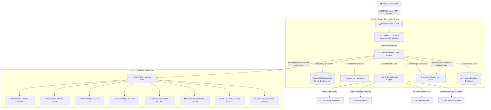

# 🌲 AIoT Intelligence Forest Protection System

Sistem perlindungan hutan terpadu berbasis **Artificial Intelligence of Things (AIoT)** yang menggabungkan penglihatan komputer (**Computer Vision & YOLOv8**), mikrokontroler **ESP32-CAM** dan **ESP32 Main Actuator Node**, **Web Dashboard Interaktif (Monitoring & Kontrol Komponen)**, **Kalibrasi Visual Sudut Servo 0°–90° dengan Proyeksi Vektor Presisi**, **Database Lokal Persisten dengan Ekspor CSV Excel**, **Sinkronisasi Cloud Global (Firebase Realtime Database)**, serta **Sistem Notifikasi Email Otomatis ke Petugas** via protokol **TCP/IP Socket**, **WebSockets (Socket.IO)**, dan **SMTP**.

---

## 📌 Fitur Unggulan Sistem

### 1. 🧠 AI Vision Tracking & Klasifikasi Multi-Insiden (ESP32-CAM + YOLOv8)
Sistem memproses streaming video resolusi tinggi secara *real-time* untuk mendeteksi 3 kategori ancaman utama:
- **🍃 Pohon Jatuh Alami (*Natural Tree Fall*)**:
  - Mengidentifikasi pohon roboh atau patah akibat cuaca ekstrem/usia.
  - **Database Lokal**: Menambah counter akumulasi (`pohon_jatuh_alami` + 1) dan mencatat log lengkap (timestamp tanggal & jam, sektor/zona, serta *confidence score*).
  - **Email Otomatis**: Mengirimkan laporan insiden ke Petugas Konservasi & Lingkungan Hidup disertai lampiran foto snapshot pohon tumbang.
- **🪓 Pohon Ditebang (*Illegal Logging Detection*)**:
  - Mendeteksi indikasi penebangan liar, sisa potongan pohon, atau aktivitas pembalakan ilegal di area konservasi.
  - **Database Lokal**: Menambah counter akumulasi (`pohon_ditebang` + 1) dan mencatat kejadian dengan koordinat bounding box.
  - **Email Otomatis**: Mengirimkan peringatan darurat ke Polisi Kehutanan & Regu Patroli Hutan dengan lampiran bukti visual.
- **🔥 Deteksi Titik Api & Pemadaman Presisi Terarah (*Precision Fire Suppression*)**:
  - Membagi area pantauan kamera menjadi **Area 1** (sisi kiri) dan **Area 2** (sisi kanan).
  - Menghitung koordinat sudut target api secara presisi ($0^\circ - 90^\circ$) memanfaatkan vektor referensi terkalibrasi.
  - Mengarahkan **Servo Tower 1 (GPIO 16)** atau **Servo Tower 2 (GPIO 17)** langsung ke posisi titik api.
  - Mengaktifkan **Relay 1 (GPIO 25)** atau **Relay 2 (GPIO 26)** untuk menyemprotkan air pemadam.
  - **Mode Ganti-Gantian (*Mutual Exclusion*)**: Jika api muncul di kedua area secara simultan, pompa menyemprot bergantian (masing-masing 2.5 detik) guna mencegah penurunan tegangan (*voltage drop / brownout*) pada mikrokontroler.
  - **Eskalasi Damkar**: Jika api tidak kunjung padam melampaui batas waktu (15 detik), sistem otomatis mengirimkan **Email Dispatch Darurat ke Pemadam Kebakaran (Damkar)** disertai foto kobaran api.

---

### 2. 🎯 Kalibrasi Visual Garis Sudut 0° & 90° Servo (`calibrate_zones.py`)
Sistem dilengkapi alat kalibrasi interaktif berbasis OpenCV untuk menjamin nozel pemadam bergerak akurat ke setiap sudut api:
- **Kalibrasi Titik Sudut Interaktif**:
  - Cukup jalankan `python calibrate_zones.py`.
  - Klik dan geser titik **S1: 0°**, **S1: 90°**, **S2: 0°**, dan **S2: 90°** langsung pada jendela video.
  - Titik referensi ini membentuk vektor dasar sudut servo untuk pemetaan matematis.
- **Proyeksi Vektor Matematika (*Vector Dot-Product Projection*)**:
  - Koordinat api $(X_f, Y_f)$ diproyeksikan secara tegak lurus ke garis vektor $0^\circ \to 90^\circ$.
  - Menghasilkan nilai sudut kontinu antara $0^\circ$ dan $90^\circ$ yang akurat sesuai posisi fisik api di lapangan.
- **Auto-Reload Tanpa Restart Server**:
  - Setiap kali konfigurasi disimpan ke `data/zones_config.json`, backend `server.py` mendeteksi perubahan berkas secara dinamis dan langsung memperbarui garis zona tanpa perlu me-restart server!
- **Overlay Video Real-Time**:
  - Streaming kamera di Web Dashboard menampilkan garis referensi $0^\circ - 90^\circ$, poligon batas zona Area 1 & 2, serta *crosshair reticle* target api lengkap dengan sudut derajat aktif.

---

### 3. ⏱️ Stabilizer Sudut Servo & Delay Pembaruan 2 Detik
Untuk mencegah motor servo mengalami *jitter* (getaran liar akibat fluktuasi bounding box AI frame-ke-frame), sistem menerapkan logika kontrol cerdas:
- **Initial Target Lock**: Saat api pertama kali terdeteksi stabil, servo langsung mengunci sudut target tanpa penundaan.
- **Interval Pembaruan 2.0 Detik (`ANGLE_UPDATE_INTERVAL = 2.0`)**: Penyesuaian sudut berikutnya hanya dikirim jika api masih menyala setelah interval 2 detik terlampaui.
- **Toleransi Deadband ($\ge 5^\circ$)**: Perubahan posisi api yang kecil ($< 5^\circ$) tidak akan menggerakkan servo, menjaga ketahanan mekanis roda gigi servo.
- **Anti-Flicker Debounce**:
  - Api harus terdeteksi konsisten selama **1.5 detik** sebelum aktuator pemadam diaktifkan.
  - Pompa tetap menyemprot selama **3.0 detik** setelah api tidak lagi terlihat untuk memastikan bara api benar-benar padam (*hold debounce*).

---

### 4. 🌐 Web Dashboard Interaktif & Multi-Device Mobile Access
Web dashboard modern berbasis **Flask**, **HTML5/CSS3 Cyber-Eco UI**, dan **WebSockets (Socket.IO)**:
- **Pusat Monitoring Real-Time**:
  - Live video streaming (MJPEG) dengan overlay deteksi YOLO, garis sudut kalibrasi, dan target reticle.
  - Indikator meteran jarak sensor ultrasonik (*proximity bar* 0–30 cm).
  - 4 Kartu metrik statistik insiden yang diperbarui secara langsung.
  - Indikator koneksi perangkat (ESP32-CAM, ESP32 Main Node, Server Hub).
- **Kendali Manual Aktuator**:
  - Slider pengatur sudut Servo Tower 1 & 2 ($0^\circ - 180^\circ$) dengan respons instan (< 5 ms).
  - Tombol uji semprot pompa air (Relay 1 & Relay 2).
  - Tombol uji nada buzzer sirine (*Beep Test*).
  - Pemilih warna lampu LED RGB (Merah, Hijau, Kuning, Biru).
- **Akses Jaringan WiFi Fleksibel**:
  - Terdapat tombol **Salin Link WiFi** untuk membuka dashboard dari HP, tablet, atau laptop lain dalam jaringan WiFi yang sama.

---

### 5. 💾 Database Lokal & Ekspor CSV untuk Microsoft Excel
Manajemen basis data lokal terstruktur (`data/forest_database.json`) yang dikelola secara *thread-safe*:
- **Pencatatan Kronologis Lengkap**: ID kejadian, stempel waktu (`YYYY-MM-DD HH:MM:SS`), tanggal, jam, tipe event, wilayah/sektor, deskripsi, confidence AI, dan sudut derajat servo.
- **Pencarian & Filter Interaktif di Web**:
  - Kotak pencarian langsung (*live search*) untuk memfilter riwayat berdasarkan kata kunci.
  - Filter tanggal harian (*Today / Specific Date*).
  - Pemilih kategori event.
- **Ekspor CSV Anti-0KB & Ramah Excel**:
  - Tombol **Export CSV** di dashboard mengunduh seluruh data riwayat insiden.
  - Menggunakan teknik streaming **Blob JavaScript** dan backend **Flask `send_file`** dengan header `Content-Length` eksplisit untuk menjamin unduhan tidak pernah 0 KB.
  - Dilengkapi karakter **UTF-8 BOM (`\ufeff`)**, sehingga simbol derajat (`°`), teks Indonesia, dan tanda baca terbuka rapi dan presisi di **Microsoft Excel**, Google Sheets, maupun LibreOffice Calc.

---

### 6. 🔥 Peringatan Bahaya Hardware Kritis (Flame Sensor Fisik — GPIO 35)
Sensor api khusus yang dipasang **langsung pada boks mikrokontroler ESP32**:
- **Pemicu Darurat**: Jika api fisik menyentuh atau berada sangat dekat dengan sirkuit ESP32 (Active LOW pada GPIO 35).
- **Banner Merah Berkedip di Web**: Menampilkan peringatan mencolok di bagian atas dashboard dengan animasi darurat dan alarm audio Web Audio API.
- **Email Darurat Protokol Hardware**: Mengirim instruksi pemutusan daya utama, pemadaman dengan APAR, dan evakuasi boks kontroler ke petugas teknis.
- **Pencatatan Otomatis**: Masuk ke database lokal (`HARDWARE_DANGER`) dan tersinkron ke Firebase Cloud.

---

### 7. 📧 Sistem Notifikasi Email Terpadu (SMTP)
Modul pengiriman email otomatis (`email_notifier.py`) berbasis *background thread*:
1. **Laporan Pohon Tumbang Alami** $\to$ Petugas Konservasi & Lingkungan Hidup.
2. **Laporan Pohon Ditebang / Pembalakan Liar** $\to$ Polisi Kehutanan & Regu Patroli.
3. **Eskalasi Kebakaran Hutan (> 15 Detik)** $\to$ Unit Pemadam Kebakaran (Damkar).
4. **Peringatan Bahaya Hardware Kritis** $\to$ Tim Teknis / Operator Lapangan.
- Setiap email menyertakan **foto snapshot** bukti visual kejadian dan catatan log resmi di `data/email_alerts.log`.

---

### 8. ☁️ Sinkronisasi Cloud Global (Firebase Realtime Database)
- Mengunggah telemetry jarak ultrasonik, status pompa relay, sudut servo, statistik akumulasi insiden, dan log kejadian ke Firebase Cloud.
- Memungkinkan pimpinan atau pihak luar memantau kondisi hutan secara daring melalui REST API Firebase dari mana saja di seluruh dunia.

---

## 📐 Arsitektur Sistem



---

## 🔌 Pin Mapping Hardware ESP32

Konfigurasi pin ini dirancang bebas dari gangguan *strapping pins* (GPIO 0, 2, 4, 12, 15) dan pin JTAG (GPIO 13, 14), menjamin servo tidak bergetar (*glitch-free*) saat proses booting:

| No | Komponen Hardware | Pin ESP32 | Tipe Pin | Fungsi & Catatan Desain |
| :---: | :--- | :---: | :---: | :--- |
| **1** | **Servo Tower 1 (Area 1)** | **GPIO 16** | Output (PWM) | Arah semprotan air Area 1 (Kiri). PWM stabil bebas konflik JTAG. |
| **2** | **Servo Tower 2 (Area 2)** | **GPIO 17** | Output (PWM) | Arah semprotan air Area 2 (Kanan). PWM stabil bebas konflik JTAG. |
| **3** | **Relay 1 (Pompa Air Area 1)** | **GPIO 25** | Digital Output | Kontrol pompa air Area 1 (*Active LOW*). Bebas glitch saat booting. |
| **4** | **Relay 2 (Pompa Air Area 2)** | **GPIO 26** | Digital Output | Kontrol pompa air Area 2 (*Active LOW*). Bebas glitch saat booting. |
| **5** | **Ultrasonic HC-SR04 TRIG** | **GPIO 33** | Digital Output | Sinyal picu ultrasonik 10 µs. |
| **6** | **Ultrasonic HC-SR04 ECHO** | **GPIO 32** | Digital Input | Pembacaan durasi pulsa gelombang pantulan. |
| **7** | **Sensor Api Fisik ESP32 (DO)** | **GPIO 35** | Input-Only (GPI) | Proteksi fisik boks kontroler. Sangat akurat tanpa pullup internal. |
| **8** | **Passive Buzzer** | **GPIO 18** | Output (PWM) | Sirine darurat api & peringatan intrusi perimeter. |
| **9** | **LED RGB - Merah (R)** | **GPIO 19** | Digital Output | Indikator Api / Bahaya Kritis. |
| **10** | **LED RGB - Hijau (G)** | **GPIO 21** | Digital Output | Indikator Status Aman / Siaga. |
| **11** | **LED RGB - Biru (B)** | **GPIO 22** | Digital Output | Indikator Terhubung / Mode Kalibrasi. |

> [!IMPORTANT]
> **Catu Daya Eksternal**:
> Motor Servo dan Relay Pompa membutuhkan suplai arus yang stabil. Gunakan **Adaptor Eksternal 5V (minimal 2A)** untuk memberi daya pada Servo dan Relay. **Wajib menghubungkan pin GND adaptor ke pin GND ESP32 (*Common Ground*)**.

---

## 🚀 Panduan Menjalankan Sistem

### 1. Instalasi Dependensi Python
Pastikan Python 3.8+ telah terpasang di komputer Anda:
```bash
pip install -r requirements.txt
```

### 2. Kalibrasi Sudut 0° & 90° Servo dan Batas Area
Sebelum mengoperasikan sistem pemadam otomatis, lakukan kalibrasi arah sudut tembak nozzle:
```bash
python calibrate_zones.py
```
- Jendela visual kamera akan terbuka.
- **Klik dan geser (drag)** titik:
  - `S1: 0°` dan `S1: 90°` untuk menetapkan rentang vektor Servo Tower 1 (Area 1).
  - `S2: 0°` dan `S2: 90°` untuk menetapkan rentang vektor Servo Tower 2 (Area 2).
  - Titik poligon `P1`, `P2`, `P3`, `P4` untuk membatasi wilayah pantauan Area 1 dan Area 2.
- Tekan tombol **`S`** pada keyboard untuk menyimpan konfigurasi ke `data/zones_config.json`.
- Tekan **`R`** untuk mereset ke posisi awal, atau **`Q`** untuk keluar.

### 3. Uji Model AI dengan Kamera Mandiri (`test_model.py`)
Untuk memverifikasi model YOLOv8 mendeteksi pohon jatuh, pohon ditebang, dan api secara visual:
```bash
python test_model.py
```
Skrip ini akan membuka feed kamera lokal/USB, menampilkan bounding box deteksi AI, label kelas, tingkat confidence, dan proyeksi derajat servo secara langsung di layar.

### 4. Menjalankan Server Utama & Web Dashboard
Jalankan server hub terpadu:
```bash
python python_backend/server.py
```
Buka browser dan akses alamat:
👉 **`http://localhost:5000`**

Di halaman Web Dashboard, Anda dapat:
- Melihat feed kamera live dengan overlay poligon area, garis referensi $0^\circ - 90^\circ$, dan reticle sudut api.
- Memantau grafik sensor ultrasonik real-time.
- Mengontrol posisi sudut servo secara manual via slider.
- Menyalakan/mematikan pompa air via tombol spray.
- Melakukan pencarian data kejadian, filter tanggal, dan mengunduh **Export CSV** untuk laporan Microsoft Excel.
- Membuka link WiFi dashboard pada HP atau perangkat lain.

### 5. Pengaturan Email Notifikasi & Firebase Cloud
- **Email (`data/email_config.json`)**:
  Masukkan alamat email pengirim Gmail dan App Password 16 karakter:
  ```json
  {
    "enabled": true,
    "smtp_server": "smtp.gmail.com",
    "smtp_port": 587,
    "use_tls": true,
    "sender_email": "email.anda@gmail.com",
    "sender_password": "xxxx xxxx xxxx xxxx",
    "recipient_emails": ["damkar@daerah.go.id", "polhut@kehutanan.go.id", "konservasi@taman.id"]
  }
  ```
- **Firebase Cloud (`data/firebase_config.json`)**:
  Masukkan URL Realtime Database Firebase Anda:
  ```json
  {
    "enabled": true,
    "database_url": "https://PROYEK-ANDA-default-rtdb.firebaseio.com",
    "sync_interval_seconds": 3
  }
  ```
  *(Lihat panduan lengkap di [`TUTORIAL_FIREBASE.md`](TUTORIAL_FIREBASE.md))*.

### 6. Upload Firmware Arduino ke Mikrokontroler
1. **ESP32-CAM**:
   - Buka `esp32_cam_firmware/esp32_cam_stream.ino` di Arduino IDE.
   - Atur nama SSID dan Password WiFi Anda.
   - Pilih board: **AI Thinker ESP32-CAM** $\to$ Upload.
2. **ESP32 Main Actuator Node**:
   - Buka `esp32_main_firmware/esp32_main_protection/esp32_main_protection.ino` di Arduino IDE.
   - Atur nama SSID dan Password WiFi Anda.
   - Pilih board: **ESP32 Dev Module** $\to$ Upload.

---

## 📊 Struktur Database Lokal & Ekspor CSV

### Skema Berkas JSON (`data/forest_database.json`)
```json
{
  "counters": {
    "pohon_jatuh_alami": 12,
    "pohon_ditebang": 5,
    "insiden_api": 8,
    "objek_masuk_ultrasonik": 24
  },
  "events": [
    {
      "id": 182,
      "timestamp": "2026-10-13 14:30:15",
      "type": "API_TERDETEKSI",
      "zone": "Area 1",
      "description": "Titik api terdeteksi di Area 1 (Sudut Servo: 64°, Conf: 92%)",
      "details": {
        "confidence": 0.92,
        "angle": 64,
        "action": "AUTO_EXTINGUISH_SPRAY"
      }
    }
  ]
}
```

### Format Berkas CSV (`forest_database_events_YYYYMMDD_HHMMSS.csv`)
Tersedia langsung melalui tombol **Export CSV** di dashboard:
| ID | Timestamp | Tanggal | Jam | Tipe Event | Wilayah / Sektor | Deskripsi Insiden | Confidence AI | Sudut Servo | Status |
| :---: | :---: | :---: | :---: | :---: | :---: | :--- | :---: | :---: | :---: |
| 182 | 2026-10-13 14:30:15 | 2026-10-13 | 14:30:15 | API_TERDETEKSI | Area 1 | Titik api terdeteksi di Area 1 (Sudut Servo: 64°, Conf: 92%) | 92% | 64° | TERCATAT |
| 181 | 2026-10-13 14:15:02 | 2026-10-13 | 14:15:02 | POHON_DITEBANG | Area 2 | Terdeteksi aktivitas pohon ditebang / illegal logging di Area 2 | 88% | - | TERCATAT |

> [!TIP]
> Berkas CSV diekspor dengan format **UTF-8 with BOM**, sehingga ketika berkas dibuka langsung di **Microsoft Excel** dengan klik ganda, teks Bahasa Indonesia, pemisahan kolom, dan simbol derajat (`°`) akan otomatis tersusun rapi tanpa perlu proses import text wizard manual.

---

## 📁 Struktur Direktori Proyek

```text
├── calibrate_zones.py          # Launcher kalibrasi interaktif 0°-90° Servo & Area
├── test_model.py               # Launcher pengujian model YOLOv8 langsung via kamera
├── main.py                     # Program AI utama dengan stabilizer anti-kedip
├── email_notifier.py           # Proxy modul email otomatis
├── firebase_manager.py         # Proxy modul sinkronisasi Firebase Cloud
├── network_config.py           # Konfigurasi sinkronisasi IP mikrokontroler
├── requirements.txt            # Daftar dependensi Python
├── TUTORIAL_FIREBASE.md        # Panduan cepat setup Firebase Realtime Database
│
├── data/
│   ├── forest_database.json    # Basis data lokal (Counters, Riwayat Kejadian, Status)
│   ├── zones_config.json       # Koordinat titik sudut kalibrasi servo (0°-90°) & poligon area
│   ├── email_config.json       # Konfigurasi SMTP & akun penerima email
│   ├── firebase_config.json    # Konfigurasi Firebase Cloud (URL & auth token)
│   ├── email_alerts.log        # Catatan resmi seluruh pengiriman email darurat
│   ├── fire_alerts/            # Arsip foto snapshot insiden api & bahaya hardware
│   └── tree_alerts/            # Arsip foto snapshot insiden pohon jatuh & ditebang
│
├── runs/                       # Bobot model terlatih YOLOv8 (best.pt)
│
├── python_backend/
│   ├── server.py               # Central Server Hub (Flask + Socket.IO + Video Stream)
│   ├── database_manager.py     # Engine database lokal JSON & ekspor CSV Excel (Thread-Safe)
│   ├── ai_detector.py          # Engine deteksi YOLOv8, proyeksi sudut 0°-90°, & auto-reload
│   ├── calibrate_zones.py      # Core script kalibrasi titik servo & area
│   ├── test_model.py           # Core script live video camera model testing
│   ├── firebase_manager.py     # Modul background async Firebase REST client
│   ├── email_notifier.py       # Engine notifikasi email 4 kategori + snapshot
│   ├── static/
│   │   ├── css/style.css       # Stylesheet Cyber-Eco UI Web Dashboard
│   │   └── js/dashboard.js     # WebSocket client, Blob CSV downloader, & danger banner
│   └── templates/
│       └── index.html          # Web Dashboard: Live Stream, Kontrol Komponen, & Log Data
│
├── esp32_cam_firmware/         # Source code Arduino firmware ESP32-CAM
└── esp32_main_firmware/        # Source code Arduino firmware ESP32 Main Actuator
```

---

## 👥 Kontributor & Lisensi
Proyek **AIoT Intelligence Forest Protection System** dikembangkan untuk pemantauan cerdas, mitigasi kebakaran hutan cepat tanggap, dan konservasi alam masa depan. Seluruh hak cipta dan lisensi berada di bawah pengawasan tim pengembang.
